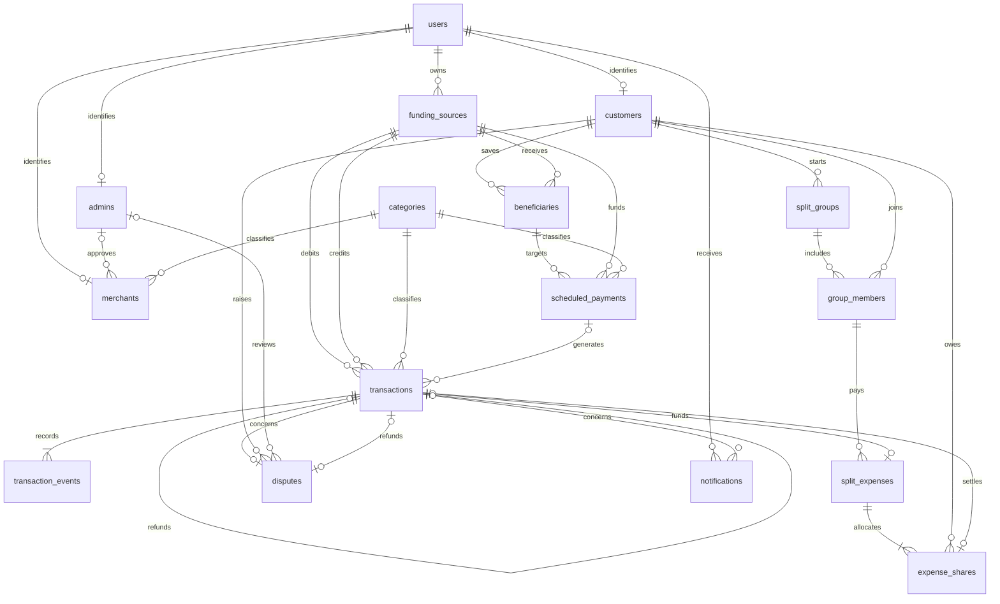

# NexusPAY

## Digital Payments and Transaction Coordination Database System

NexusPAY is a DBMS project developed using MySQL. It stores customer and merchant details, bank and wallet balances, payment records, scheduled payments, group expenses, and disputes.

The project includes an ER model, a relational schema, sample data, stored procedures, triggers, views, and SQL queries.

## Features

- Customer, merchant, platform admin, and bank admin records.
- Peer-to-peer payments, merchant payments, and bank-to-wallet transfers in both directions.
- Balance checks, payment limits, and duplicate-payment prevention.
- Payment history with successful and failed transaction states.
- Recurring payment schedules with modification and cancellation.
- Equal and custom expense splits, participant acceptance, and repayments.
- Dispute review and full refunds for standalone payments.
- Spending summaries, merchant revenue, and bank transaction reports.

## Database schema

The implementation contains 16 tables:

- `users`, `customers`, `merchants`, `admins`
- `funding_sources`, `beneficiaries`, `categories`
- `transactions`, `transaction_events`, `scheduled_payments`
- `split_groups`, `group_members`, `split_expenses`, `expense_shares`
- `disputes`, `notifications`

The initial ER model contains 14 entities. Individual expense shares and transaction events are stored separately in the implementation. Bank accounts and wallets use `funding_sources`; `bank_accounts` is a view of its bank records.

## ER diagram



[Original ER diagram](ER_diagram.pdf)

## Project files

- [01_schema.sql](sql/01_schema.sql): database tables, primary keys, foreign keys, constraints, and indexes.
- [02_routines.sql](sql/02_routines.sql): payment, scheduling, split settlement, and dispute procedures and triggers.
- [03_views.sql](sql/03_views.sql): transaction history and reporting views.
- [04_seed.sql](sql/04_seed.sql): sample records.
- [05_queries.sql](sql/05_queries.sql): joins, summaries, subqueries, reconciliation, and example procedure calls.

## How to run

Use MySQL 8.4 or later. In MySQL Workbench, open and execute the five SQL files in numbered order, starting with `01_schema.sql`.

To run from a terminal:

```bash
mysql -u root -p < sql/01_schema.sql
mysql -u root -p < sql/02_routines.sql
mysql -u root -p < sql/03_views.sql
mysql -u root -p < sql/04_seed.sql
mysql -u root -p < sql/05_queries.sql
```

Run the setup once on a fresh database. The scripts do not replace an existing installation.

## Sample queries

```sql
USE nexuspay;
SET time_zone = '+00:00';

SELECT * FROM transaction_history;
SELECT * FROM customer_spending;
SELECT * FROM merchant_revenue;
SELECT * FROM outstanding_shares;
```

The sample data includes a Rs. 600 lunch payment from Nisha to Campus Cafe, split equally with Arjun. His accepted Rs. 300 share can be repaid using:

```sql
CALL settle_share('lunch-repayment-001', 1, 2, 2, 5);
```

Call payment procedures outside an existing transaction and use a unique reference for each payment request.

## Project documents

- [Software Requirements Specification and UML diagrams](docs/SRS.pdf)
- [Database design and normalization analysis](docs/NexusPay_DB_design.pdf)

## Scope

This repository implements the database with sample balances. Authentication, real bank integration, and notification delivery require an application. Scheduled payments execute when a backend job calls `run_due_payments()`. Partial refunds and refunds involving group payments are not implemented.

## License

[MIT](LICENSE)
