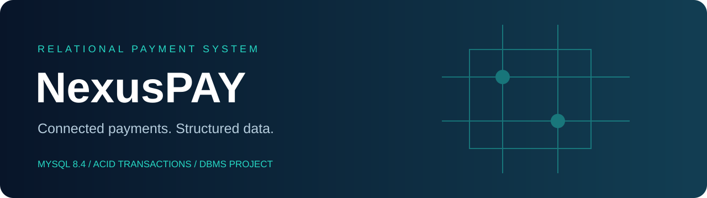

<p align="center"></p>

<p align="center">


</p>

# NexusPAY

A database-first digital payment project built around customers, merchants, bank accounts, shared expenses, and dispute management. NexusPAY demonstrates relational modeling, referential integrity, atomic money movement, reusable reporting, and meaningful SQL validation.

**Scope:** an educational MySQL implementation with fictional INR balances. It does not connect to banks or payment networks and has no web interface or authentication service.

## What it demonstrates

- **Atomic merchant payments:** account row locks, ownership validation, balance checks, rollback on failure, and a unique request key that rejects duplicate requests without a second debit.
- **Relational integrity:** 15 InnoDB tables, foreign keys, unique constraints, positive amounts, and at most one primary account per user.
- **Shared expenses:** group membership, expense records, and individual settlement shares.
- **Payment operations:** saved beneficiaries, scheduled instructions, admin-reviewed disputes, and payment notifications.
- **SQL analytics:** spending and revenue views, joins, aggregates, correlated subqueries, window functions, and indexed history lookups.
- **Repeatable setup:** Docker Compose and a MySQL 8.4 GitHub Actions validation job.

## Start locally

Requires Docker Desktop with Compose. Run from the repository root:

```bash
cp .env.example .env
# Edit .env and choose a local database password.
docker compose up -d --wait
docker compose exec db sh -c 'MYSQL_PWD="$MYSQL_ROOT_PASSWORD" mysql -uroot nexuspay'
```

Inside MySQL:

```sql
SELECT * FROM customer_spending;
SELECT * FROM merchant_revenue;
SELECT * FROM outstanding_shares;
CALL pay_merchant('my-payment-002', 1, 1, 'DEMO-C001', 'DEMO-M001', 125.00);
```

After initialization, Nisha has **INR 9,400**, Arjun has **INR 8,000**, and Campus Cafe has **INR 600**. Arjun's outstanding lunch share is **INR 300**.

Run the demonstration queries and checks:

```bash
docker compose exec -T db sh -c 'MYSQL_PWD="$MYSQL_ROOT_PASSWORD" mysql -uroot' < sql/05_queries.sql
docker compose exec -T db sh -c 'MYSQL_PWD="$MYSQL_ROOT_PASSWORD" mysql -uroot' < tests/verify.sql
```

Initialization runs only on an empty database volume. `docker compose down` preserves data. To deliberately erase the local demo database and rebuild it, run `docker compose down -v`, then start again. Never use that reset on data you need.

### Existing MySQL server

Use MySQL 8.4 or later on a fresh instance. Run these in order; enter your password when prompted:

```bash
mysql -u root -p < sql/01_schema.sql
mysql -u root -p < sql/02_routines.sql
mysql -u root -p < sql/03_views.sql
mysql -u root -p < sql/04_seed.sql
mysql -u root -p < tests/verify.sql
```

## Repository guide

```text
NexusPAY/
├── sql/
│   ├── 01_schema.sql       # Tables, constraints, relationships, indexes
│   ├── 02_routines.sql     # Atomic payment procedure and ownership triggers
│   ├── 03_views.sql        # Spending, revenue, and settlement reports
│   ├── 04_seed.sql         # Fictional, deterministic demonstration dataset
│   └── 05_queries.sql      # DBMS presentation and analytics queries
├── tests/verify.sql        # Integrity and payment rollback assertions
├── docs/
│   ├── ER_diagram.pdf      # Original supplied design reference
│   ├── design.md           # Implemented model and design decisions
│   └── assets/banner.svg
├── .github/workflows/database.yml
├── compose.yaml
└── .env.example
```

## Design and learning notes

Read [the implemented model](docs/design.md) for relationships, normalization decisions, and limitations, and the [data dictionary](docs/data-dictionary.md) for entity definitions. The [original ER diagram](docs/ER_diagram.pdf) is preserved as a reference; the SQL corrects its circular group/expense dependency and separates per-person shares.

The payment routine owns its transaction boundary: call it outside an existing transaction. Duplicate request keys raise an error; they do not return a cached success response. Applications should distinguish a duplicate from a failed new payment and reconcile the original request. Deadlocks may still require bounded retries using the same request key.

Scheduled payments store instructions only; no background scheduler or person-to-person transfer engine is included. Split settlement status is bookkeeping rather than an automatic bank transfer. Authentication, production authorization, currency conversion, immutable accounting journals, fraud detection, and external payment processing are future extensions. Direct table writes can bypass routine-level payment rules, so a real application must restrict its database privileges.

## License

[MIT](LICENSE).
