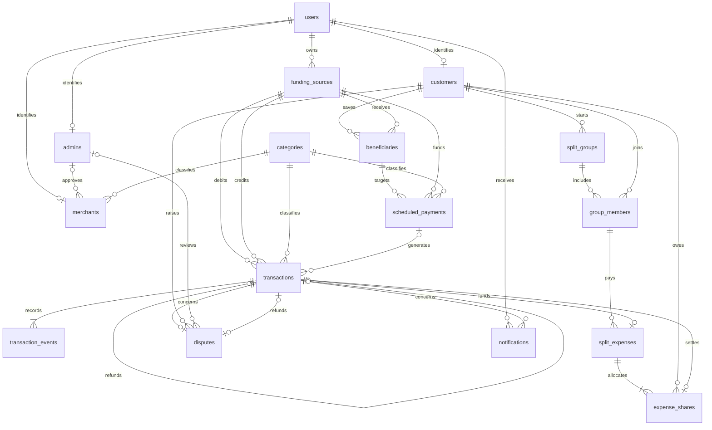

# NexusPAY

**Digital Payments and Transaction Coordination Database System**

A MySQL database for customer and merchant payments, bank and wallet transfers, recurring payment instructions, group expenses, and disputes. This repository contains the database implementation of the NexusPay project described in the SRS.

## Project documents

- [SRS and UML diagrams](docs/SRS.pdf): requirements, actors, and activity diagrams for payments, splits, schedules, disputes, and bank-to-wallet transfers.
- [Database design and normalization notes](docs/NexusPay_DB_design.pdf): the original normalization analysis.
- [Original ER diagram](ER_diagram.pdf): the initial 14-entity model.

The original documents are preserved. The implemented schema has **16 tables**: individual shares and transaction-state events are separate relations. `funding_sources` extends the original bank-account concept to cover wallets; `bank_accounts` remains available as a view. Platform and bank admins share the `admins` table with different scopes.

## Files and setup

```text
sql/
  01_schema.sql    Tables, keys, constraints, and indexes
  02_routines.sql  Payment, schedule, split, and dispute operations
  03_views.sql     History, spending, revenue, bank logs, and pending shares
  04_seed.sql      Fictional sample data
  05_queries.sql   Reports, reconciliation, and example calls
```

Use MySQL 8.4 and a fresh database. Open the SQL files in MySQL Workbench and execute them in numbered order, or run:

```bash
mysql -u root -p < sql/01_schema.sql
mysql -u root -p < sql/02_routines.sql
mysql -u root -p < sql/03_views.sql
mysql -u root -p < sql/04_seed.sql
mysql -u root -p < sql/05_queries.sql
```

These are installation scripts, not migrations. They do not drop existing data, and rerunning them against installed tables causes errors. An older NexusPAY installation needs a separate fresh database instance or a planned migration. Use UTC for application and scheduler sessions:

```sql
USE nexuspay;
SET time_zone = '+00:00';
```

## Main operations

**Payments.** `make_payment` checks the payer's source ownership and saved beneficiary verification. It supports peer payments, merchant payments, bank-to-wallet transfers, and wallet-to-bank transfers. Account balances are locked and updated together. The default limits are Rs. 10,000 per payment and Rs. 50,000 per UTC day, configurable per customer. Daily limits count all successful outgoing non-refund transfers, including wallet funding.

Payment details cannot be updated or deleted. Lifecycle events are appended as `INITIATED → AUTHORIZED → PENDING → SUCCESSFUL`, or a transition to `FAILED`. Balance and limit failures are recorded without moving money. Invalid inputs, unknown or unverified beneficiaries, duplicate request keys, and SQL errors are rejected. Duplicate requests raise an error rather than returning a cached result.

**Schedules.** A schedule stores its source, verified beneficiary, amount, frequency, and dates. `run_due_payments` processes one due occurrence per active schedule per call. Each occurrence has a unique reference. Both successful and financially failed attempts advance to the next date; the schedule stays active until its end date. Monthly recurrence adds one calendar month to the previous due date. Schedules can be modified, paused, or cancelled.

**Group expenses.** `create_split` allocates a successful payment equally across group members, or accepts custom shares as a JSON array. Equal splits distribute any remaining paise in customer-ID order. Custom shares must be positive, unique, belong to members, include the payer, and sum to the payment amount. Members accept or decline a request through `respond_to_split`. `settle_share` transfers money to the original payer and marks the share settled only after success.

**Disputes.** Only the payer may raise one dispute against a successful original payment. A platform admin can reject it or approve a full refund through `resolve_dispute`. An approved refund reverses the original source and destination and is linked to the final decision, reviewer, notes, and timestamp. Failed refunds leave the dispute open and roll back the attempted refund. Group expenses and share repayments require reconciliation before a refund and are rejected by this routine; partial refunds are not implemented.

**Reports.** Views provide current transaction states, gross customer spending excluding transfers between the customer's own sources, merchant revenue net of refunds, annual merchant summaries, bank-related logs, and pending split shares. Both payer and payee receive database notification records for processed payment attempts.

## Sample workflow

The sample includes Nisha, Arjun, Campus Cafe, a platform admin, and a bank admin. Nisha pays Rs. 600 for lunch, moves Rs. 200 to her wallet, withdraws Rs. 50, and makes a separate Rs. 100 payment that has an open dispute. Her bank balance is Rs. 9,150, her wallet holds Rs. 150, and the cafe holds Rs. 700. Arjun has accepted his unpaid Rs. 300 lunch share.

Run these calls individually after inspecting the sample data. They change the database:

```sql
SELECT * FROM transaction_history;
SELECT * FROM outstanding_shares;

-- Arjun repays Nisha: split 1, customer 2, source 2, beneficiary 5.
CALL settle_share('lunch-repayment-001', 1, 2, 2, 5);

-- Platform admin 1 approves the separate Rs. 100 payment dispute.
CALL resolve_dispute(1, 1, TRUE, 'Extra item confirmed; full refund approved');

-- Nisha sends Rs. 125 to her verified beneficiary Arjun.
CALL make_payment('peer-payment-001', 1, 2, 1, 'TRANSFER', 125.00);

-- A backend scheduler would invoke this periodically in a UTC session.
CALL run_due_payments();

UPDATE scheduled_payments SET status='CANCELLED' WHERE schedule_id=1;
```

Call the public operations outside an existing transaction; they manage their own transaction boundaries. `post_transfer` and `validate_schedule` are internal helpers. Financial operations should go through the public procedures, not direct table writes. Concurrent callers must handle SQL deadlocks with a bounded retry and reuse the same payment reference.

## Implemented relationships



## Notes on normalization and LLD

Membership uses `(group_id, customer_id)` as its key; `joined_at` describes that membership. Shares use `(split_id, customer_id)`. The expense total comes from the linked payment, rather than being repeated in each share. Schedule ownership comes from its beneficiary. User profile data and category descriptions are stored in their respective tables.

The normalization PDF uses several different field names and describes earlier hypothetical schemas. Adding a surrogate key alone does not prove 2NF; all candidate keys and functional dependencies must be considered. A foreign key to another table does not by itself violate BCNF. The PDF is a design reference, not a formal BCNF proof of this physical schema. Balances are maintained totals, and the generated primary-source column is an implementation constraint.

The SRS use-case diagram identifies actors and their operations. Its activity diagrams provide validation branches and success/failure flows for LLD. They can guide future `PaymentService`, `ScheduleService`, `SplitService`, and `DisputeService` classes. Class responsibilities, method contracts, and sequence diagrams still need to be designed; the SRS contents list a sequence diagram, but no populated sequence-diagram page is included.

## Remaining application work

The database models the SRS workflows, but it is not the complete full-stack application. Login, password hashing and verification, caller authorization, beneficiary verification with a bank, actual bank settlement and reconciliation, notification delivery, and the frontend remain application work. Sample credentials are disabled placeholders.

A backend job must call the schedule procedure; automatic execution is not enabled by these scripts. Bank log views need caller-specific filtering and are not access-control boundaries. Before connecting an application, configure least-privilege accounts: do not grant direct financial-table writes or execution of internal helpers. SQL admin IDs describe reviewers; they do not authenticate a caller. The SRS performance, availability, and external integration goals have not been established by this database demo.

The SQL was tested on MySQL 8.4.11, including concurrent requests, duplicate references, balance and spending limits, immutable history, schedule failures, split acceptance and settlement, rounding, and dispute refunds.

## License

[MIT](LICENSE)
