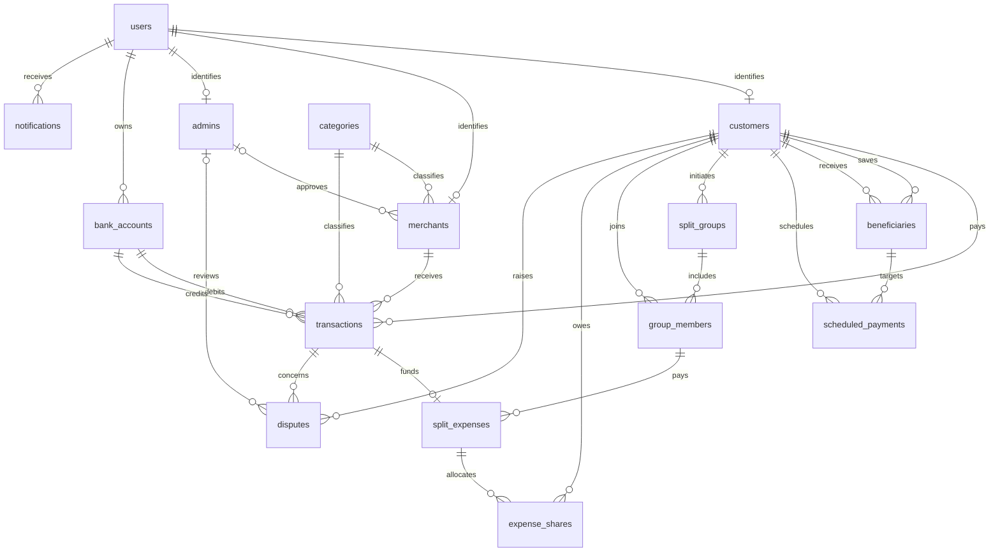

# Database design

The tables in `sql/01_schema.sql` are based on the payment system shown in the original ER diagram. A few relationships were changed during implementation, mainly around group expenses and scheduled payments.

## Relationships

## Design decisions

User details are stored in `users`. Customer, merchant, and admin details are kept in separate tables, with a unique `user_id` linking each profile to a user. This avoids storing the same email and password details in several places.

A split group can have several expenses, so `split_expenses` references the group. The group does not need to reference an expense in return. `group_members` uses the group and customer IDs together as its primary key, which prevents the same customer from joining a group twice.

The total cost belongs to `split_expenses`, while each person's amount belongs to `expense_shares`. For example, a Rs. 600 lunch can have two Rs. 300 shares without repeating the total cost in each share record.

A beneficiary is another customer saved by a customer. Scheduled payments reference these saved beneficiaries. Merchant payments are stored separately in `transactions`; this implementation does not execute customer-to-customer transfers.

## Normalization and integrity

User identity, customer details, merchant details, categories, and memberships are separate relations. Non-key descriptive attributes belong to their owning entity. Membership and share relations use composite keys. Transaction category is a historical classification snapshot; later merchant category changes should not rewrite past payments. Account balances are deliberately maintained aggregates for this simulation, updated together by the payment routine.

The database enforces foreign keys, unique email and request keys, positive money amounts, nonnegative balances, basic date consistency, schedule beneficiary ownership, and one primary account per user. Payment account ownership is checked inside the procedure. Foreign keys default to restrictive deletion to preserve referenced history.

The SQL does not enforce every business rule. The following checks would need to be added in an application: user role must agree with its subtype; group initiators should join their group; shares must belong to group members and sum to the expense total; expense totals and payers must match the linked payment; only the payer should raise a dispute. The demo satisfies these rules, and the query file includes a share-total reconciliation query. They are not all enforced by the schema.

## Payment transaction

1. Validate amount, request key, and distinct accounts.
2. Begin a transaction and resolve customer/merchant ownership.
3. Lock both account rows in account-number order.
4. Validate ownership and available balance.
5. Insert the completed payment with a unique request key.
6. Debit the payer, credit the merchant, and insert a notification.
7. Commit. Any SQL exception rolls back the whole operation.

All amounts use DECIMAL(15,2) and represent INR. Failed payments are rolled back and do not leave a transaction record. The project updates account balances directly; it does not maintain a separate accounting ledger.

## Demonstration sequence

Start a fresh database, inspect the spending views, execute a new merchant payment, and rerun the views. Run the verification script to demonstrate that duplicate requests, insufficient funds, invalid ownership, and invalid beneficiaries leave balances intact. Finish with outstanding split shares and the indexed history EXPLAIN query.
