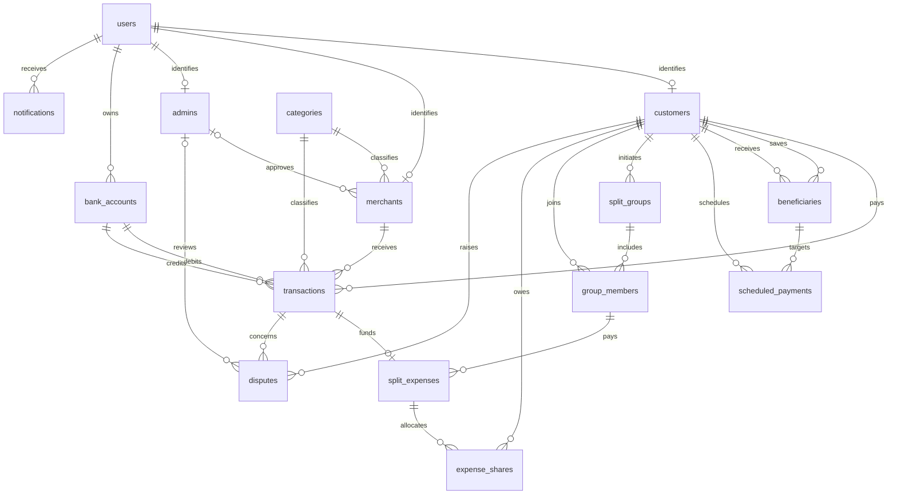

# Database design

The executable schema in `sql/01_schema.sql` is the source of truth. The supplied ER diagram is the original conceptual reference.

## Relationships

## Corrections to the supplied SQL

- Create referenced tables first and use consistent lower-case plural names.
- Remove the circular split-group-to-expense foreign key. A group owns many expenses; each expense references one group.
- Use one auto-increment identifier per table and a composite membership primary key without auto-increment.
- Make customer references integers and point beneficiaries to their own table.
- Fix misspelled references and the trailing comma in disputes.
- Store credential hashes only in users; remove duplicate admin passwords.
- Represent each participant's share in expense_shares rather than repeating expense totals.
- Keep scheduled person-to-person instructions separate from merchant payment transactions, since no person-to-person execution engine exists here.

## Normalization and integrity

User identity, customer details, merchant details, categories, and memberships are separate relations. Non-key descriptive attributes belong to their owning entity. Membership and share relations use composite keys. Transaction category is a historical classification snapshot; later merchant category changes should not rewrite past payments. Account balances are deliberately maintained aggregates for this simulation, updated together by the payment routine.

The database enforces foreign keys, unique email and request keys, positive money amounts, nonnegative balances, basic date consistency, schedule beneficiary ownership, and one primary account per user. Payment account ownership is checked inside the procedure. Foreign keys default to restrictive deletion to preserve referenced history.

Some cross-row rules remain application responsibilities: user role must agree with its subtype; group initiators should join their group; shares must belong to group members and sum to the expense total; expense totals and payers must match the linked payment; only the payer should raise a dispute. The demo satisfies these rules, and the query file includes a share-total reconciliation query. They are not all enforced by the schema.

## Payment transaction

1. Validate amount, request key, and distinct accounts.
2. Begin a transaction and resolve customer/merchant ownership.
3. Lock both account rows in account-number order.
4. Validate ownership and available balance.
5. Insert the completed payment with a unique request key.
6. Debit the payer, credit the merchant, and insert a notification.
7. Commit. Any SQL exception rolls back the whole operation.

All amounts use DECIMAL(15,2) and represent INR. Failed payments leave no transaction record; a production service would need a separate attempt/audit stream. This is an account-balance simulation rather than a double-entry ledger.

## Demonstration sequence

Start a fresh database, inspect the spending views, execute a new merchant payment, and rerun the views. Run the verification script to demonstrate that duplicate requests, insufficient funds, invalid ownership, and invalid beneficiaries leave balances intact. Finish with outstanding split shares and the indexed history EXPLAIN query.
